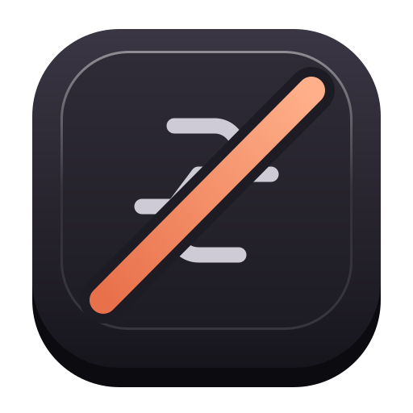

<p align="center">
  
</p>

<h1 align="center">Unpilot</h1>

<p align="center"><b>Make the Copilot key do anything.</b><br>Windows only &middot; free &middot; <a href="https://awnsh.github.io/unpilot">awnsh.github.io/unpilot</a></p>

Your laptop came with a Copilot key you never asked for. Be honest: when did you last open Copilot on purpose?

Tell Unpilot what that key should do instead, in plain words, and get a one-line install. Free, no account, and nothing leaves your browser.

**Make yours:** https://awnsh.github.io/unpilot

> **Windows only.** This is for Windows PCs with a Copilot key. Not affiliated with Microsoft or Anthropic.

| | Copilot key does |
| --- | --- |
| **Before** | Opens the Microsoft Copilot app |
| **After** | Whatever you said: act as right Ctrl, play/pause, take a screenshot, open an app or site, type text, run a command, or open a Claude popup |

## How it works

1. **Describe it** on the website, like "act like right Ctrl" or "open Spotify". The page works out what you mean right in your browser with a built-in interpreter. If Chrome's on-device AI (Gemini Nano) is available, it helps with anything the interpreter doesn't recognize. Nothing is uploaded either way.
2. **Paste one line** into PowerShell. It looks like this:
   ```powershell
   $env:COPILOT_KEY='<your choice>'; irm https://raw.githubusercontent.com/awnsh/unpilot/main/install.ps1 | iex
   ```
3. **Press the key.**

The Copilot key secretly sends `Win+Shift+F23`. A small background script catches exactly that combination before Windows hands it to Copilot, and does your action instead. Every other key passes through untouched.

## What the key can do

| Action | Example | What happens |
| --- | --- | --- |
| `remap` | `RCtrl` | Acts as that key for as long as you hold it, so Copilot + C = Ctrl + C. Works with RCtrl, RAlt, Apps, CapsLock, F13 to F24 and more |
| `keys` | `Win+Shift+S`, `MediaPlayPause` | Presses a shortcut or media key |
| `app` | `spotify:`, `notepad`, `C:\path\app.exe` | Opens an app, a Windows link, or an .exe |
| `url` | `https://chatgpt.com` | Opens a website |
| `text` | `Best,\nYour Name` | Types text where your cursor is |
| `command` | `rundll32.exe user32.dll,LockWorkStation` | Runs a PowerShell command silently |
| `claude` | (none) | Opens the liquid-glass Claude popup (see below) |

Your choice is saved in `%LOCALAPPDATA%\Unpilot\config.json`. You can edit it by hand and sign out and back in, or just run a new line from the website.

## The Claude popup

Pick "open the Claude popup" and the Copilot key opens a liquid-glass pill over whatever you're doing:

- **Enter** asks, and the reply streams in under your question. Keep typing to follow up.
- **Ctrl+Enter** hands the question to the Claude desktop app's Quick Entry, so it's saved in your chat history.
- **Esc** or clicking away closes it and clears the conversation.

It talks to Claude through the **Claude Code CLI** (`claude -p`) using your own Claude plan, with no API key. You need a paid plan that includes Claude Code, plus a one-time `claude auth login`; the installer checks this for you. The glass is a blurred snapshot of the screen behind the popup, taken when it opens and discarded when it closes.

## Uninstall

```powershell
irm https://raw.githubusercontent.com/awnsh/unpilot/main/uninstall.ps1 | iex
```

This stops the script, removes the Startup launcher, and deletes `%LOCALAPPDATA%\Unpilot`. Your Copilot key opens Copilot again.

## Privacy & safety

- The website never sends what you type anywhere.
- The installer touches only your user folder and Startup folder. It needs no admin rights.
- The keyboard hook only acts on `F23`.
- `command` actions run exactly what you typed, so only use commands you understand.

## License

[MIT](LICENSE). Copilot is a trademark of Microsoft. Claude is a trademark of Anthropic.
